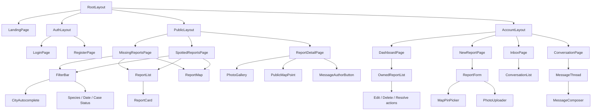

# PawFinder Component Architecture

This is the proposed MVP route and component structure based on the [PawFinder specification](./pawfinder-spec.md). Route groups organize layouts without adding URL segments. The tree is a target structure for implementation; most of these files do not exist yet.

## App Router routes

| Route                     | Access                   | Purpose                                                                                |
| ------------------------- | ------------------------ | -------------------------------------------------------------------------------------- |
| `/`                       | Public                   | Overview, quick links, and featured active alerts                                      |
| `/login`                  | Public                   | Sign in                                                                                |
| `/register`               | Public                   | Create an account                                                                      |
| `/missing`                | Public                   | Browse missing-pet reports with city, species, date, and case-status filters and a map |
| `/spotted`                | Public                   | Browse Spotted and In temporary care reports with the same search tools                |
| `/reports/new`            | Signed in                | Submit a Missing, Spotted, or In temporary care report                                 |
| `/reports/[id]`           | Public                   | View report details, photos, public map point, and message-author action               |
| `/dashboard`              | Signed in                | Manage preferred city and owned reports                                                |
| `/inbox`                  | Signed in                | List private conversations                                                             |
| `/inbox/[conversationId]` | Conversation participant | Read and send private messages                                                         |

## Proposed project structure

```text
app/
├── layout.tsx                   # Root document, metadata, global styles
├── page.tsx                     # /
├── (auth)/
│   ├── layout.tsx               # Shared sign-in/register layout
│   ├── login/page.tsx            # /login
│   └── register/page.tsx         # /register
├── (public)/
│   ├── layout.tsx               # Public header and footer
│   ├── missing/page.tsx          # /missing
│   ├── spotted/page.tsx          # /spotted
│   └── reports/[id]/page.tsx     # /reports/[id]
└── (account)/
    ├── layout.tsx               # Signed-in navigation and access boundary
    ├── dashboard/page.tsx         # /dashboard
    ├── reports/new/page.tsx       # /reports/new
    └── inbox/
        ├── page.tsx              # /inbox
        └── [conversationId]/page.tsx # /inbox/[conversationId]

components/
├── layout/                       # Header, Footer, MainNavigation
├── reports/                      # ReportCard, ReportList, ReportDetails, ReportStatusBadge
├── search/                       # FilterBar, CityAutocomplete, SpeciesFilter, DateFilter
├── map/                          # ReportMap, MapMarker, MapPinPicker
├── forms/                        # ReportForm, PhotoUploader, FormField
├── messaging/                    # ConversationList, MessageThread, MessageComposer
└── ui/                            # Shared buttons, inputs, dialogs, loading and empty states

lib/
├── auth/                          # Session and authorization helpers
├── db/                            # Database client and query functions
├── validation/                    # Shared input schemas
└── actions/                       # Server actions or route-handler operations
types/                             # Shared TypeScript domain types
```

Keep route-specific data loading and page composition close to each `page.tsx`; place reusable presentation elements in `components/`. Protect account routes and verify record ownership on the server, not only in the UI. Public report and map data must not include conversation content, phone numbers, or private pickup/care addresses.

## Component hierarchy



## Week 04 implementation priority

1. **Foundation and shared shell** — establish the root layout, public/account layouts, navigation, shared UI primitives, and typed report/status values.
2. **Public discovery slice** — implement `/missing`, `/spotted`, and `/reports/[id]` using shared report cards, filters, and a map placeholder or provider adapter. This validates the public report shape and keeps the two browse sections consistent.
3. **Report creation** — implement `/reports/new` for all three report labels, including validation, photo selection, and author-selected public map point.
4. **Account workflow** — add `/login`, `/register`, and `/dashboard`, including preferred city and owned-report management.
5. **Messaging** — add inbox and conversation pages with participant-only access.

This is a suggested build order, not a change to the specification's provisional P1/P2 commitments. Confirm the scope and ordering as a team before treating it as a release plan.
