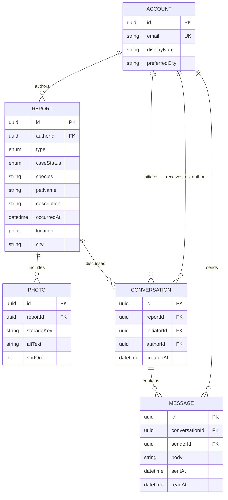

# PawFinder Data Model

This is a proposed MVP model based on the [PawFinder specification](./pawfinder-spec.md). It uses five core entities and intentionally keeps public report information separate from private messages.

## Database choice

**Recommendation: PostgreSQL** for the MVP. PawFinder has strongly related accounts, reports, photos, conversations, and messages, and relational constraints help preserve ownership and conversation relationships. Store a report's public map point as a geographic point; add **PostGIS** if distance-based or spatial queries are needed. The team should confirm this recommendation because the specification leaves the database open.

## Core entities

### Account

| Field           | Type / notes                                    |
| --------------- | ----------------------------------------------- |
| `id`            | Primary key                                     |
| `email`         | Required, unique                                |
| `displayName`   | Required                                        |
| `preferredCity` | Optional city label used to initialize searches |
| `createdAt`     | Account creation timestamp                      |

Authentication credentials/session data are managed by the selected authentication approach; they are not exposed through public account data.

### Report

| Field                        | Type / notes                                                      |
| ---------------------------- | ----------------------------------------------------------------- |
| `id`                         | Primary key                                                       |
| `authorId`                   | Foreign key to `Account.id`                                       |
| `type`                       | `MISSING`, `SPOTTED`, or `TEMPORARY_CARE`                         |
| `caseStatus`                 | `ACTIVE` or `RESOLVED`; distinct from `type`                      |
| `species`                    | Required, filterable animal species                               |
| `petName`                    | Optional; primarily applicable to Missing reports                 |
| `description`                | Required report description                                       |
| `identifyingCharacteristics` | Optional details, such as color or markings                       |
| `occurredAt`                 | Last-seen date for Missing; observation date/time for other types |
| `location`                   | Required author-selected public map point                         |
| `city`                       | City label associated with the public point, used for city search |
| `createdAt`, `updatedAt`     | Record timestamps                                                 |

The report type determines which report fields are applicable. Spotted and Temporary Care reports do not require a linked Missing report. A report's public point must never be replaced with a privately shared pickup/care address.

### Photo

| Field        | Type / notes                                                         |
| ------------ | -------------------------------------------------------------------- |
| `id`         | Primary key                                                          |
| `reportId`   | Foreign key to `Report.id`                                           |
| `storageKey` | Reference to the uploaded image in the selected file-storage service |
| `altText`    | Accessible description                                               |
| `sortOrder`  | Display order within the report                                      |
| `createdAt`  | Upload timestamp                                                     |

### Conversation

| Field         | Type / notes                                            |
| ------------- | ------------------------------------------------------- |
| `id`          | Primary key                                             |
| `reportId`    | Foreign key to the report being discussed               |
| `initiatorId` | Foreign key to the account that starts the conversation |
| `authorId`    | Foreign key to the report's author                      |
| `createdAt`   | Conversation creation timestamp                         |

For the MVP, allow at most one conversation per `(reportId, initiatorId)`. `authorId` must match the linked report's `authorId`; the initiator cannot be the report author.

### Message

| Field            | Type / notes                                                    |
| ---------------- | --------------------------------------------------------------- |
| `id`             | Primary key                                                     |
| `conversationId` | Foreign key to `Conversation.id`                                |
| `senderId`       | Foreign key to `Account.id`; must be a conversation participant |
| `body`           | Required private message text                                   |
| `sentAt`         | Message timestamp                                               |
| `readAt`         | Optional timestamp for inbox read state                         |

Phone numbers and pickup/care addresses may be shared in message text, so messages must remain private to the conversation participants and must never be included in public report or map responses.

## Entity relationships

## Relationship and access rules

- One account can author many reports; each report has exactly one author.
- One report can have many photos and many conversations. Each conversation is tied to one report and its author.
- One conversation has many messages. Each message has one sender, who must be one of that conversation's two participants.
- A conversation can be opened by a signed-in user contacting the report author; a user cannot start a conversation with themself.
- Only the report author can edit, delete, or resolve their report. Only conversation participants can read or send messages in that conversation.
- Public report/map queries return report details, photos, and the public point only; they do not return messages or private contact/care information.
- `type` (`MISSING`, `SPOTTED`, `TEMPORARY_CARE`) and `caseStatus` (`ACTIVE`, `RESOLVED`) are independent fields. Resolving a case must not change its report type.
